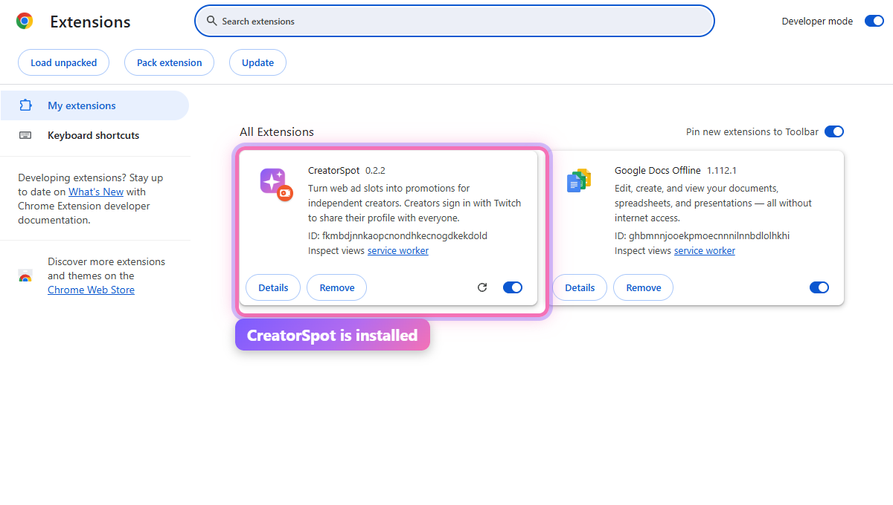
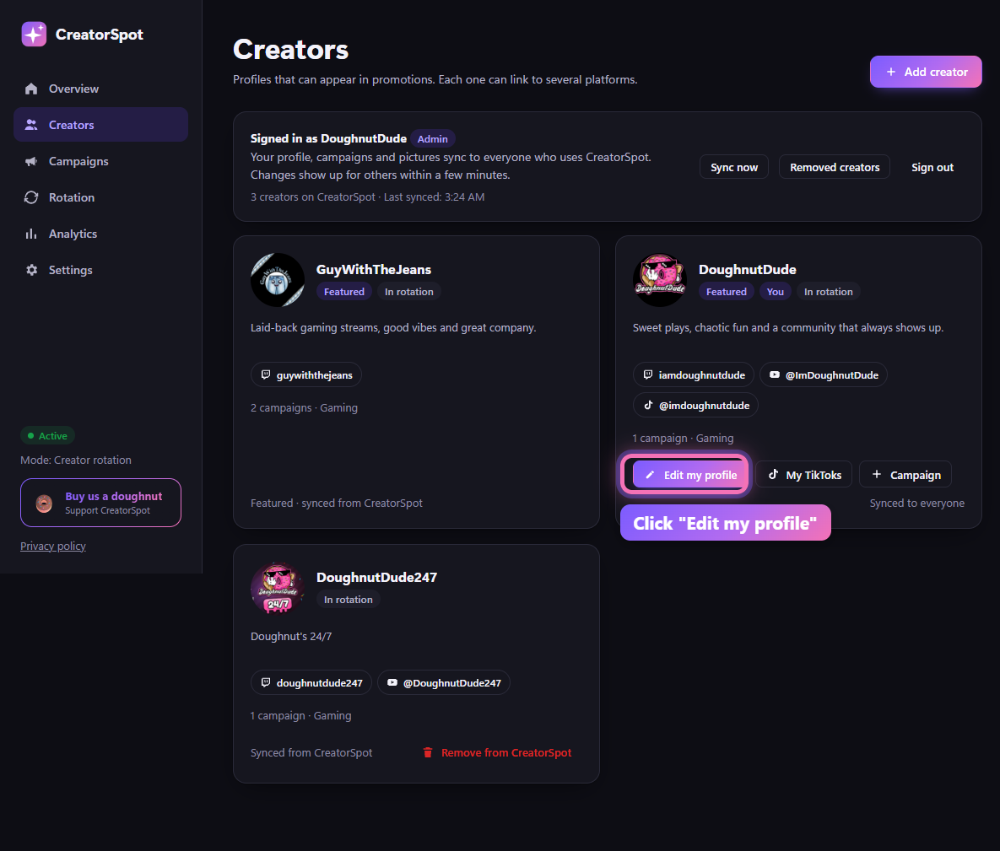

# CreatorSpot

[](https://streamlabs.com/guywiththejeans1/tip)

CreatorSpot is a browser extension that turns website ad slots into promotions for independent streamers. Instead of a random ad, you see a labeled "Creator promo" for a real creator, with a link straight to their channel.

* Works in **Chrome, Brave and Edge**. A Firefox build exists but is untested.
* **Creators sign in with Twitch.** Their profile, promos, pictures and TikToks show up for everyone who uses CreatorSpot within about a minute.
* **TikTok backgrounds.** A creator's own TikToks can play behind their promo, muted, with a button to turn the sound on.
* **Updates install themselves.** No reinstalling.
* **Private.** CreatorSpot never records or sends what you browse. Viewers never need an account.

Made by [GuyWithTheJeans](https://www.twitch.tv/guywiththejeans) and [iamDoughnutDude](https://www.twitch.tv/iamdoughnutdude).

---

## How to install (about 2 minutes)

> **Sorry this takes a few steps!** Right now this is the easiest way to install CreatorSpot: Chrome and Brave only allow one-click installs from the Chrome Web Store. You only do it once, and a pop-up window shows you every click.

**Step 1. Download:** **[CreatorSpot (ZIP)](https://github.com/GuyWithTheJeans/CreatorSpot/raw/main/downloads/CreatorSpot-for-Chrome.zip)**. It works in Chrome, Brave and Edge.

**Step 2. Unzip it.** Right-click the ZIP and click **Extract All...**


**Step 3.** Click **Browse...**, pick **Desktop**, then click **Extract**.


**Step 4.** Open the new **CreatorSpot** folder on your Desktop and double-click **Install CreatorSpot**. A window pops up and walks you through the rest, one picture at a time. If Windows asks whether to run it, click **Run** (or **More info**, then **Run anyway**).

> Tip: opening the ZIP and double-clicking **Install CreatorSpot** inside it also works. It unzips itself to your Desktop first.

<details><summary>Prefer to read the steps here? (same pictures as the pop-up)</summary>

1. Open `chrome://extensions` (Brave: `brave://extensions`, Edge: `edge://extensions`) and turn on **Developer mode**.<br>
2. Click **Load unpacked**.<br>
3. Click **Desktop**, click the **CreatorSpot** folder once, then click **Select Folder**.<br>
4. CreatorSpot is installed.<br>
5. Pin it: click the puzzle piece, then the pin.<br>
6. Streamers: open the dashboard, click **Creators**, then **Sign in with Twitch**.<br>
7. Then click **Edit my profile** to add your links and promos.<br>

</details>

### Keeping it working

* **Keep the CreatorSpot folder where you put it**, and leave **Developer mode on**. The browser runs CreatorSpot from that folder.
* **Updates install themselves.** CreatorSpot checks for a new version every 10 minutes (and whenever you open its popup), downloads it, and restarts, keeping your sign-in and settings. If an update ever gets stuck, click the CreatorSpot icon and press **Update now**. If the popup says *Automatic updates are off*, double-click **Install CreatorSpot** in your CreatorSpot folder once.
* New creators and profile changes show up by themselves. You never reinstall for those.

---

## For streamers

1. **Sign in:** click the CreatorSpot icon, then **Open dashboard** → **Creators** → **Sign in with Twitch**. Your Twitch name, picture and channel link are filled in for you.
2. **Edit my profile:** add your bio, color, and more links (YouTube, TikTok, Kick, Discord, a tip page, a website).
3. **My TikToks:** click **My TikToks** on your card, paste a TikTok link (on tiktok.com: open the video, click **Share**, then **Copy link**) and click **Add**. The video shows up playing so you know it worked. Click **Save my TikToks**, and all your promos play them in the background.
4. **Campaigns:** each campaign is one promo design: headline, message, button text, style, which link it opens, schedule and priority. A live preview shows it at different ad sizes.

Everything you save shows up for every CreatorSpot user within about a minute. Only you can change your own profile.

---

## How to use it

* **Toolbar popup:** turn CreatorSpot on or off, pause it on the current site, switch the rotation mode, and see who is being promoted.
* **Dashboard → Overview:** what's active right now, displays and clicks.
* **Dashboard → Creators:** your account, and everyone in the rotation. Creators you add only on this computer can also be edited here. GuyWithTheJeans and iamDoughnutDude are **featured** creators: they're always in the rotation.
* **Dashboard → Campaigns:** all promo designs as a grid, with previews.
* **Dashboard → Rotation:** choose *Promote myself*, *Creator rotation*, *Creator circle* or *Mixed*, and set limits. The fairness preview shows who comes next.
* **Dashboard → Analytics:** displays, clicks and click rate. A display only counts when at least half the promo is visible for one second, and these numbers stay on your computer.
* **Dashboard → Settings:** theme, TikTok videos on/off, YouTube companion card, paused websites, backup and restore.

## Privacy

CreatorSpot looks at the structure of the pages you visit, only inside your browser, to find ad slots. It never records or sends your browsing. The only things it downloads are public creator profiles (from CreatorSpot's database), new versions (from this GitHub page), creators' pictures, and TikTok's player for promos that include a TikTok, which you can switch off in Settings. The full policy is in the extension's **Privacy policy** link.

## Rules CreatorSpot follows

* Every promo is labeled **"Creator promo · CreatorSpot"**.
* Video ads inside players (such as YouTube's) are never touched. A creator card may appear next to the player instead.
* Full-screen pop-up ads are never replaced, and things a website hid on purpose are never shown.
* No fake views or clicks, ever.

---

## Developing

```
extension/        The extension (manifest, background, promo designs, dashboard, popup, welcome tour)
  lib/            Engine: platforms, rotation, storage, accounts (cloud.js), updates (shared.js), renderer
  content/        Ad-slot detection and page handling (add new ad types in sites.js)
tools/            Test runners and build scripts; tools/easy-install/ ships inside the download
tests/            Unit tests (Node's built-in test runner, no install needed)
test-site/        Local page with realistic ad slots, used by the browser tests
supabase/         Database setup for creator accounts (run setup.sql in Supabase's SQL Editor)
downloads/        The ZIP served by the download link above
docs/             Architecture, checklist, roadmap, store listing, install pictures
```

Tests:

```powershell
node --test tests/
```

```powershell
node tools/e2e.mjs chrome edge brave
```

```powershell
node tools/tiktok-check.mjs chrome
```

```powershell
node tools/autoupdate-check.mjs chrome
```

**Releasing a new version:**
1. Bump the version in `extension/manifest.json` and `extension/lib/core.js`.
2. Run the tests.
3. Run `powershell -ExecutionPolicy Bypass -File tools/make-share-zip.ps1`.
4. Commit and push. Every install updates itself within about 10 minutes.

See [docs/ARCHITECTURE.md](docs/ARCHITECTURE.md) for how it fits together.
