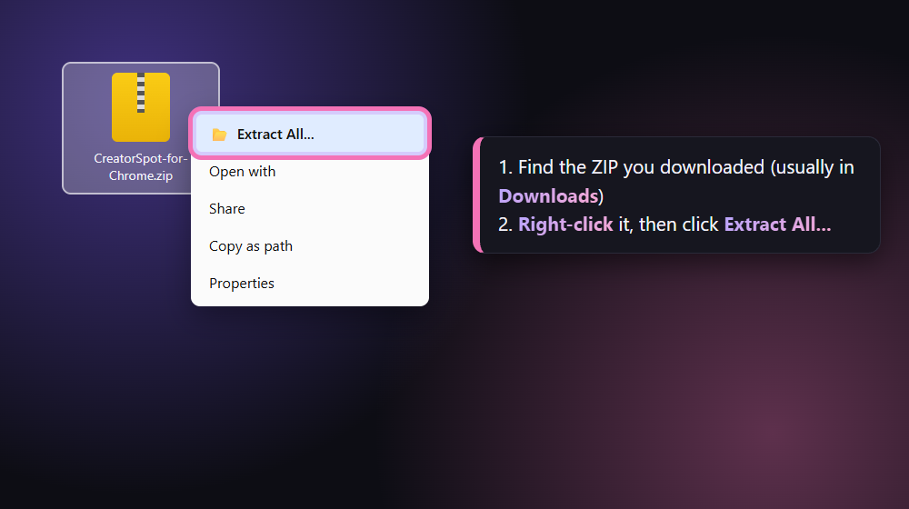
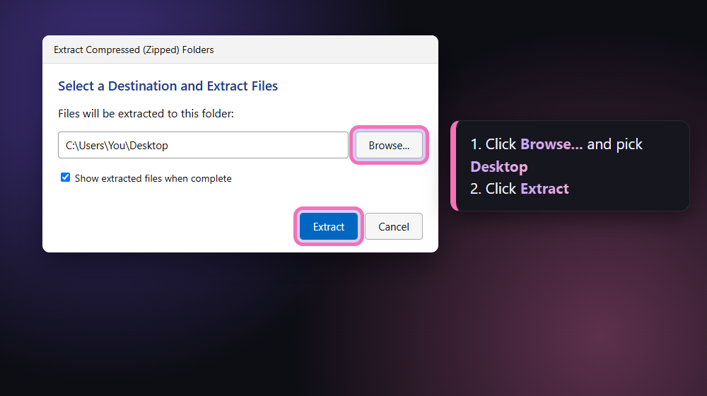
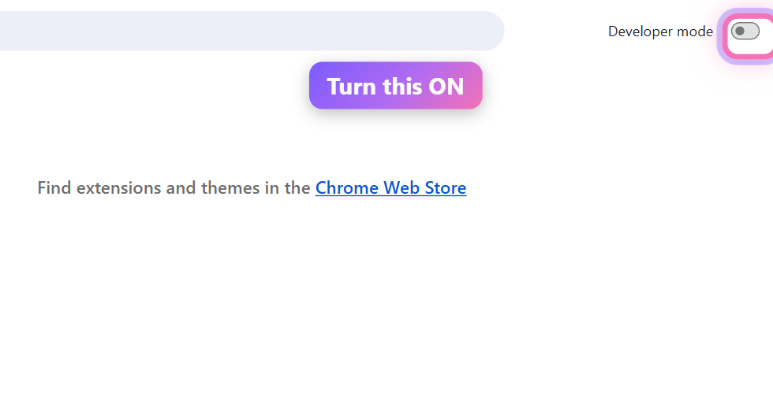
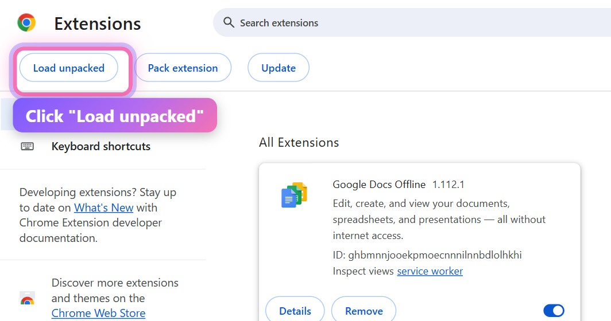
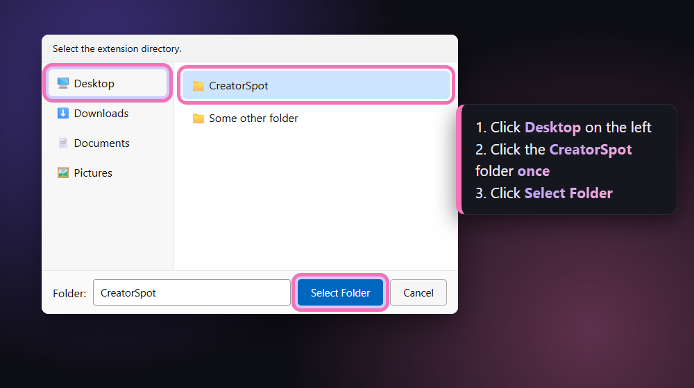
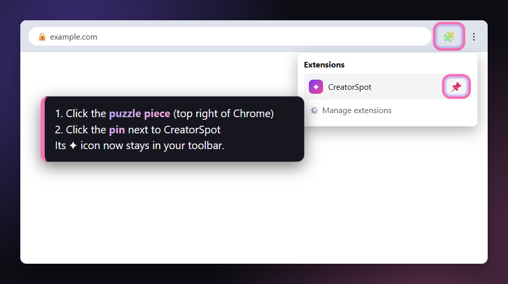
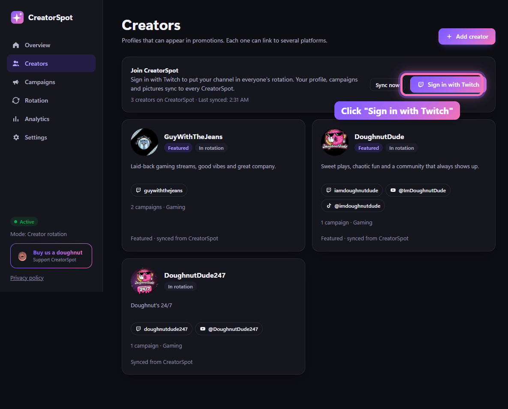

# CreatorSpot

[](https://streamlabs.com/guywiththejeans/tip)

CreatorSpot is a browser extension that turns standard website ad slots into promotions for independent creators. Creators can promote themselves, or join a fair rotation in which they promote one another.

* Works in **Chrome, Brave, Edge and Opera** from one package. Tested automatically in Chrome 157, Edge 158 and Brave 1.100.
* Built for **Firefox 121+** from the same code, but not yet tested. See the checklist.
* No build step and no dependencies. Your browsing never leaves your browser; the only downloads are public creator profiles and the version check.

## How to install (about 2 minutes)

> **Sorry this takes a few steps!** Right now this is the easiest way to install CreatorSpot: Chrome and Brave only allow one-click installs from the Chrome Web Store. You only do it once, and a pop-up window shows you every click.

**Step 1. Download:** **[CreatorSpot (ZIP)](https://github.com/GuyWithTheJeans/CreatorSpot/raw/main/downloads/CreatorSpot-for-Chrome.zip)**. It works in Chrome, Brave and Edge.

**Step 2. Unzip it.** Right-click the ZIP and click **Extract All...**



**Step 3.** Click **Browse...**, pick **Desktop**, then click **Extract**.



**Step 4.** Open the new **CreatorSpot** folder on your Desktop and double-click **Install CreatorSpot**. A window pops up and walks you through the rest, one picture at a time. If Windows asks whether to run it, click **Run** (or **More info**, then **Run anyway**).

<details><summary>Prefer to read the steps here? (same pictures as the pop-up)</summary>

1. Open `chrome://extensions` (Brave: `brave://extensions`, Edge: `edge://extensions`) and turn on **Developer mode**.<br>
2. Click **Load unpacked**.<br>
3. Click **Desktop**, click the **CreatorSpot** folder once, then click **Select Folder**.<br>
4. CreatorSpot is installed.<br>
5. Pin it: click the puzzle piece, then the pin.<br>
6. Streamers: open the dashboard, click **Creators**, then **Sign in with Twitch**.<br>
7. Then click **Edit my profile** to add your links and promos.<br>

</details>

**Updates install themselves.** When a new version comes out, CreatorSpot downloads it and restarts on its own, keeping your sign-in and settings. Leave Developer mode on and keep the CreatorSpot folder where it is. If an update ever gets stuck, click the CreatorSpot icon and press **Update now**.

New creators and profile changes show up automatically. You never reinstall for those.

## Creator accounts

Creators open the CreatorSpot dashboard, go to **Creators** and click **Sign in with Twitch**. Their profile, campaigns, pictures and videos then sync to every CreatorSpot within a few minutes. Everyone who signs in joins the creator rotation. GuyWithTheJeans and iamDoughnutDude are featured and can remove abusive profiles.

Accounts run on [Supabase](https://supabase.com). `supabase/setup.sql` creates the database. Every creator can change only their own profile, enforced by row-level security in the database.

## Install it (the easy way)

1. Open the **CreatorSpot** folder on your Desktop.
2. Double-click **Install CreatorSpot**. A small window walks you through the rest with two "Copy" buttons.

That's it. The folder also has a **HOW TO INSTALL** note with the same steps.

To give it to a friend, right-click the CreatorSpot folder, choose **Send to → Compressed (zipped) folder**, and send them the ZIP. They unzip it to their Desktop and double-click **Install CreatorSpot**.

To rebuild that Desktop folder after code changes, run:

```powershell
powershell -ExecutionPolicy Bypass -File tools/make-desktop-install.ps1
```

A one-click "Add to Brave" button needs the extension to be published on the Chrome Web Store (Brave installs from it). `docs/STORE_LISTING.md` has everything for that submission.

**Firefox (untested):** open `about:debugging#/runtime/this-firefox`, click **Load Temporary Add-on…** and select `extension/manifest.json`. Then grant the "Access your data for all websites" permission when Firefox asks; Firefox makes site access optional for MV3 extensions.

### Update to a new version

Replace the contents of the `extension` folder with the new files, then click the **reload** icon on the CreatorSpot card on the extensions page. Settings, creators and statistics are kept.

### Back up or move your setup

Go to Dashboard → Settings → **Export backup**. In another browser, choose **Import backup**. Twitch credentials are never included in backups.

## How to use it

* **Toolbar popup:** turn CreatorSpot on or off, pause it on the current site, switch the rotation mode, and see who is being promoted.
* **Dashboard → Creators:** add, edit or remove creator profiles. Each profile can link to Twitch, YouTube, TikTok, Kick, Discord or any website. GuyWithTheJeans and iamDoughnutDude are **featured creators**: they ship with every install and always stay in the rotation in every mode (they cannot be removed, excluded or paused). Anyone can add their own channel, and it rotates alongside them. The featured list lives in one place: `CS.FEATURED_IDS` and `defaultCreators()` in `extension/lib/defaults.js`.
* **Dashboard → Campaigns:** create promotions (headline, message, button text, format, destination, priority, schedule, background image or video) with a live preview at five ad sizes.
* **Dashboard → Rotation:** choose *Promote myself*, *Creator rotation*, *Creator circle* or *Mixed*, and set frequency caps. The fairness preview shows the next 12 placements and the expected share for each creator.
* **Dashboard → Analytics:** displays, clicks and click rate per creator and per campaign, stored on this device. A display only counts when at least half the promotion is visible for one second.

## Developing

```
extension/        The extension itself (load this folder)
  lib/            Shared engine: platforms, rotation, storage, renderer, schema
  content/        Site adapters, placement detection, page orchestration
  popup/ dashboard/ onboarding/ ui/   User interface and design system
tests/            Unit tests (Node's built-in test runner, no install needed)
tools/            End-to-end and real-site test runners, icon and package scripts
test-site/        Local page with realistic ad slots, used by the e2e tests
docs/             Architecture, checklist, store listing, roadmap
```

Run the unit tests:

```powershell
node --test tests/
```

Run the end-to-end acceptance tests. These load the real extension into each installed browser, headless:

```powershell
node tools/e2e.mjs chrome edge brave
```

Other checks:

```powershell
node tools/youtube-check.mjs chrome
```

```powershell
node tools/real-sites.mjs chrome
```

Build store ZIP files into `dist/`:

```powershell
powershell -ExecutionPolicy Bypass -File tools/package.ps1
```

Regenerate the icons:

```powershell
powershell -ExecutionPolicy Bypass -File tools/make-icons.ps1
```

To add a new creator platform, add one entry to `extension/lib/platforms.js`. To support a new website's ad markup, add an adapter to `extension/content/sites.js`. See [docs/ARCHITECTURE.md](docs/ARCHITECTURE.md).
